<!-- Panels are generated by scripts/build_assets.py from the portfolio (agent-console theme). Edit content there, then rerun it. -->

<a href="https://www.madhusiddharths.com"></a>

  
  <a href="https://www.madhusiddharths.com">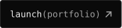</a>
  <a href="https://www.linkedin.com/in/madhu-siddharth-suthagar/">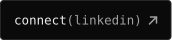</a>
  



<a href="https://www.madhusiddharths.com/work/pulsetrade/"></a> <a href="https://www.madhusiddharths.com/work/pulsetrade/">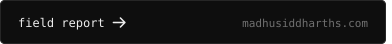</a>

<a href="https://www.madhusiddharths.com/work/alzheimers/"></a> 

<a href="https://www.madhusiddharths.com/work/growth-retention/">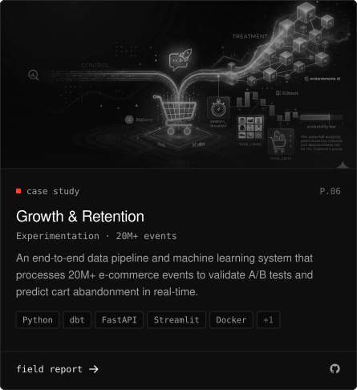</a><a href="https://www.madhusiddharths.com/work/crypto-tweet-impact/">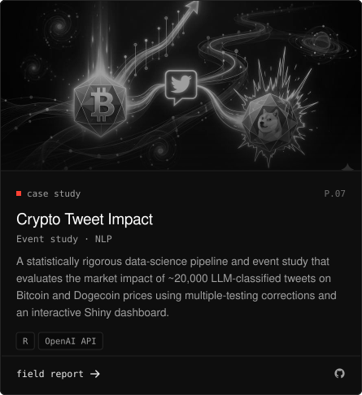</a> 

  <a href="https://ieeexplore.ieee.org/document/11395795">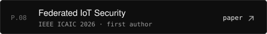</a>
  <a href="https://www.madhusiddharths.com/work/online-retail/">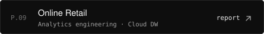</a>
  <a href="https://www.madhusiddharths.com/work/image-retrieval/">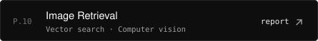</a>
  <a href="https://www.madhusiddharths.com/work/traffic-prediction/">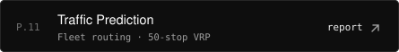</a>
  <a href="https://www.madhusiddharths.com/work/saturdae/">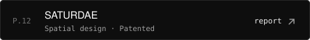</a>
  

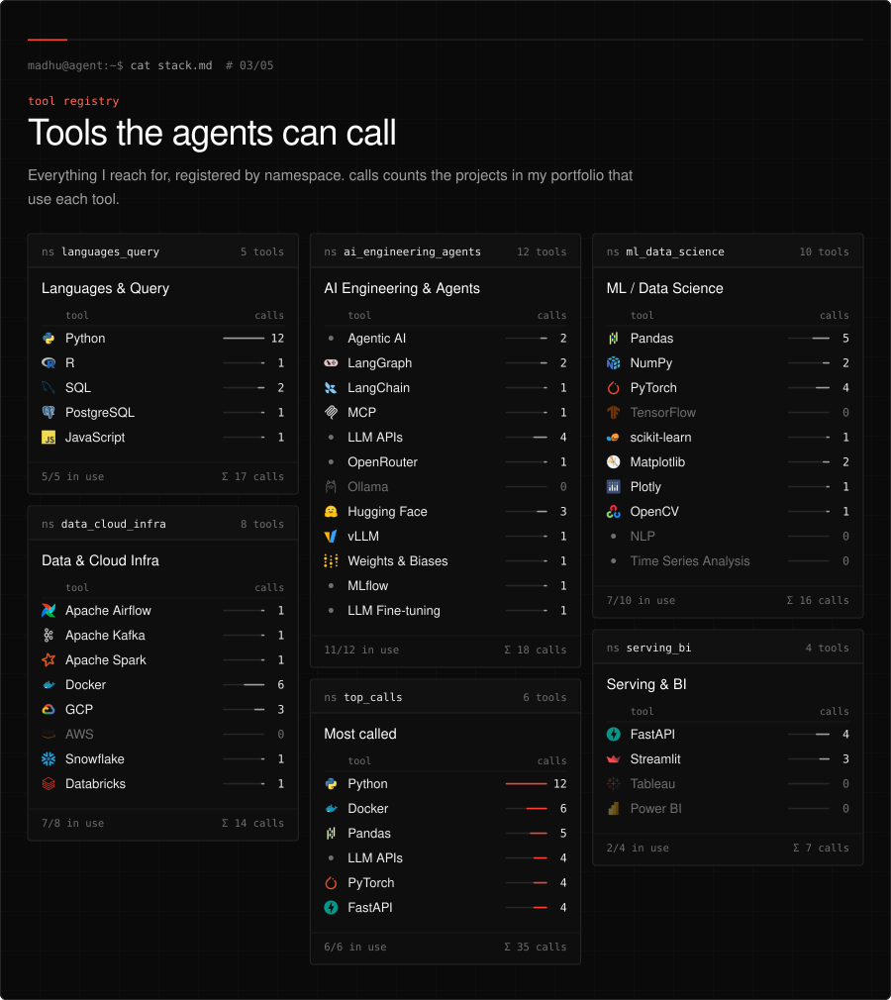

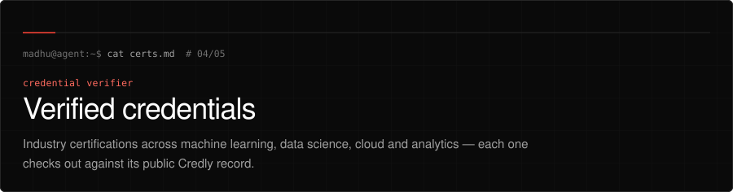

  
  
  <a href="https://www.credly.com/badges/b6bad1eb-1fa3-4947-98bb-692045b56d7f/public_url">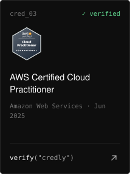</a>
  

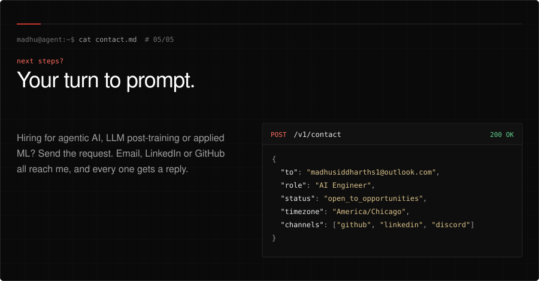

  
  
  
  

<a href="https://www.madhusiddharths.com">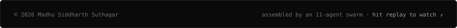</a>
